# CAPS Turnos

Sistema de turnos para un **Centro de Atención Primaria de la Salud (CAPS)**.
La secretaría organiza médicos, horarios y turnos; el médico atiende, hace recetas y lleva la ficha clínica; el paciente saca, confirma y cancela sus turnos desde la computadora o el celular.

> Trabajo de tesis. Funciona **solo en una computadora local** (sin nube) y todos los datos de ejemplo son **ficticios**.

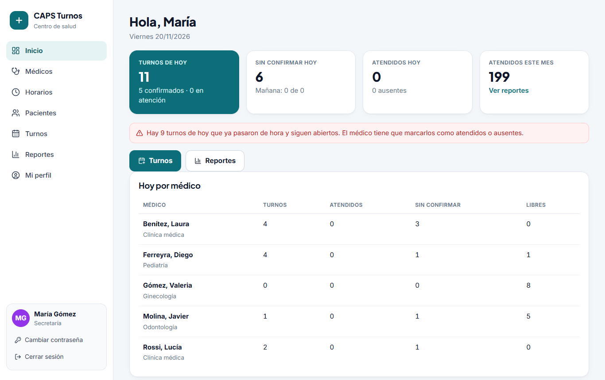

---

## Índice

- [Qué hace cada usuario](#qué-hace-cada-usuario)
- [Capturas](#capturas)
- [Instalación en una PC nueva](#instalación-en-una-pc-nueva)
- [Actualizar a una versión nueva](#actualizar-a-una-versión-nueva)
- [Uso diario](#uso-diario)
- [Copias de seguridad](#copias-de-seguridad)
- [Mails (recuperar la clave y recordatorios)](#mails-recuperar-la-clave-y-recordatorios)
- [Reglas del sistema](#reglas-del-sistema)
- [Cómo está hecho](#cómo-está-hecho)
- [Para programar](#para-programar)
- [Límites](#límites)

---

## Qué hace cada usuario

Se entra con el **DNI** y una contraseña. Cada usuario ve solo su menú. Todas las listas tienen **filtros** (con un botón "Limpiar filtros").

### Secretaría
- **Inicio:** turnos del día, cuántos faltan confirmar, atendidos del mes, avisos (feriados, licencias, médicos sin horarios) y un calendario semanal con la ocupación de cada médico.
- **Médicos:** alta, edición, baja y reactivación; especialidades; clave temporal para el primer ingreso.
- **Horarios:** días y horas de atención de cada médico, licencias y feriados.
- **Pacientes:** alta, edición, baja y búsqueda por apellido, nombre o DNI.
- **Turnos:** calendario con los horarios libres, reserva, reprogramación y cancelación.
- **Reportes:** atendidos por médico y por mes, ausentismo y promedio mensual, con descarga en Excel (con título, ordenado de más a menos y una hoja con filtros).

### Médico
- **Inicio:** el siguiente paciente y los números del día, la semana y el mes.
- **Agenda del día:** marcar a cada paciente como "en atención", "atendido" o "ausente". Muestra las alergias.
- **Pantalla de atención:** signos vitales, motivo, diagnóstico y notas. Una atención terminada no se edita: se corrige con notas.
- **Ficha clínica** (antecedentes, alergias, medicación), con historial de versiones.
- **Recetas** imprimibles, que se pueden anular.
- **Pacientes:** solo los que tuvieron turno con él.
- **Mis ausencias:** avisar los días que no va a atender; esos días no se dan turnos con él.

### Paciente
- Ver los médicos, sus días de atención y el próximo turno libre.
- **Sacar turno** eligiendo médico, día y hora (hasta 5 turnos vigentes).
- **Mis turnos:** próximos, historial y cancelados; confirmar o cancelar.
- **Mis recetas** y **Mi ficha**.
- Recibe un **mail 24 horas antes** con un enlace para confirmar el turno.

---

## Capturas

| Agenda del médico | Médicos (vista del paciente) |
| --- | --- |
| 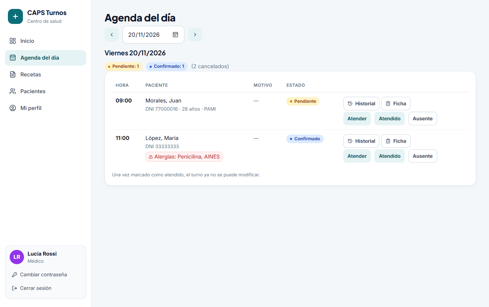 | 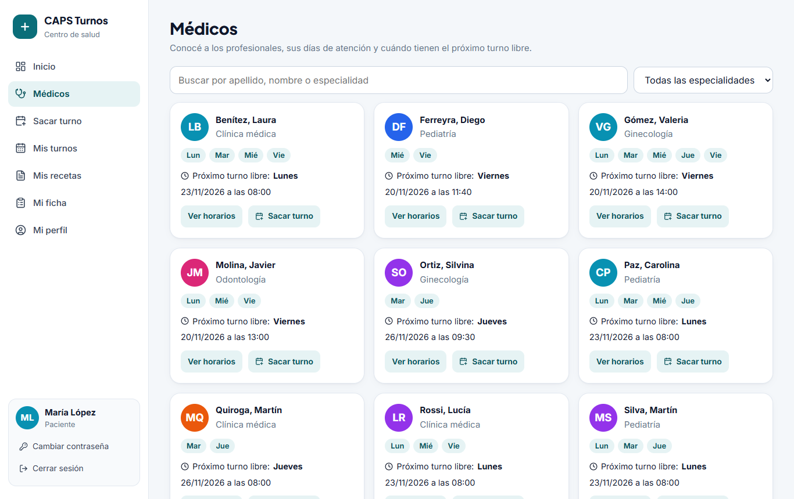 |

| Reportes | Receta imprimible |
| --- | --- |
| 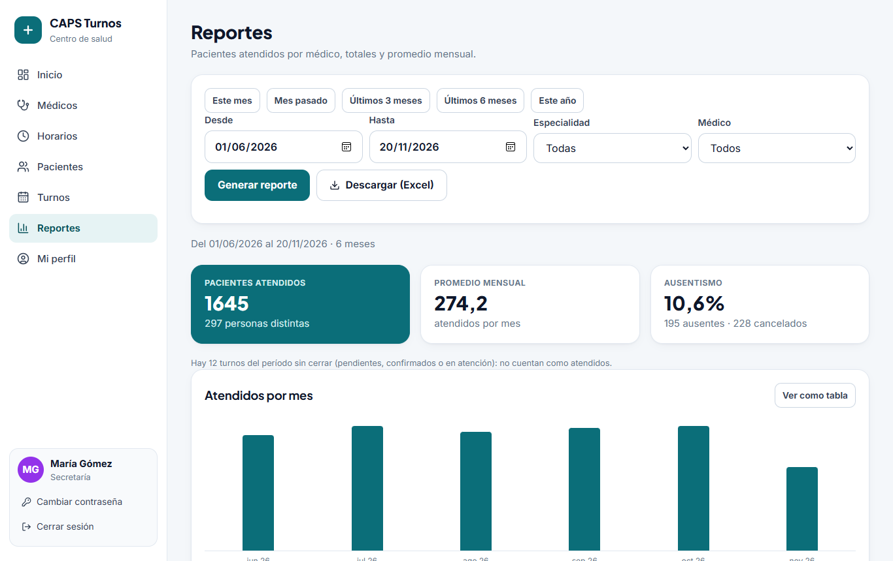 | 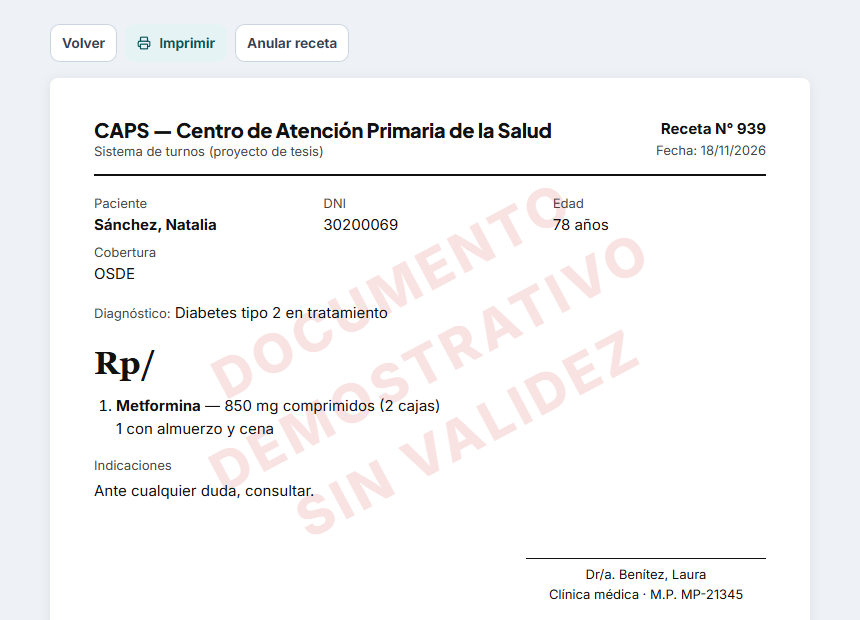 |

**Se adapta a cada pantalla.** En la computadora el menú va al costado; en la tableta, arriba, y las listas se ven como tarjetas de a dos; en el celular hay una barra abajo con las secciones principales.

| Celular: paciente | Celular: médico | Celular: secretaría |
| --- | --- | --- |
| 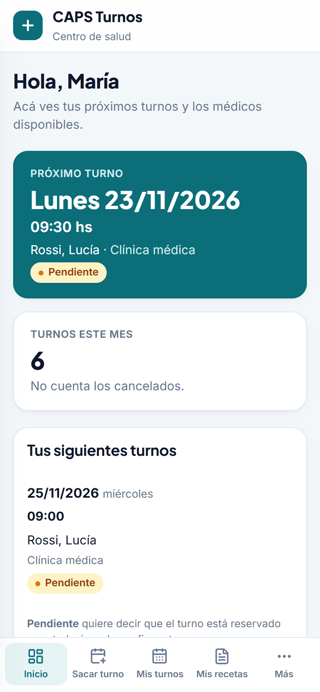 | 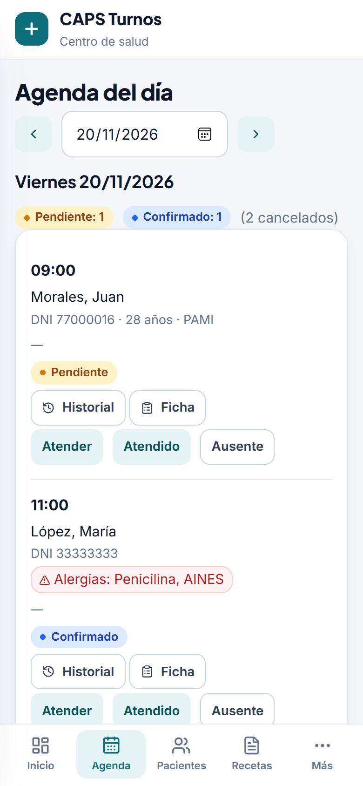 | 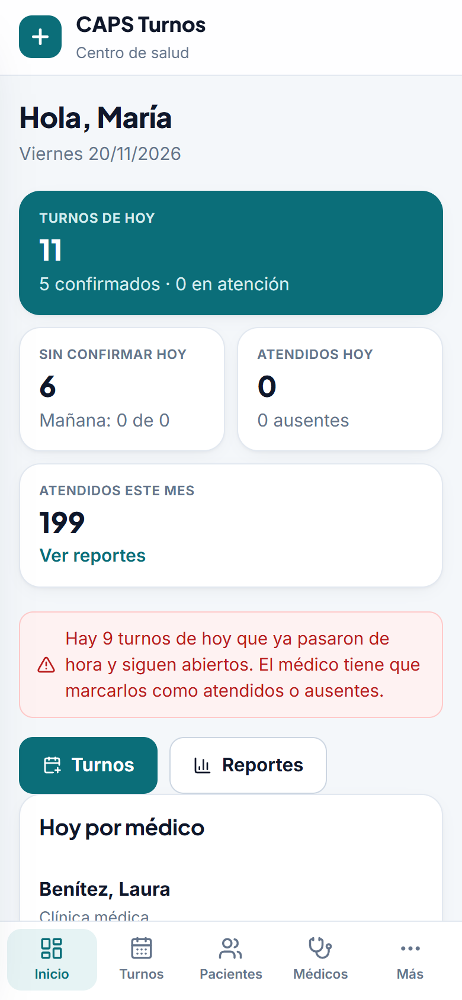 |

<details>
<summary>Más capturas (ingreso y tableta)</summary>

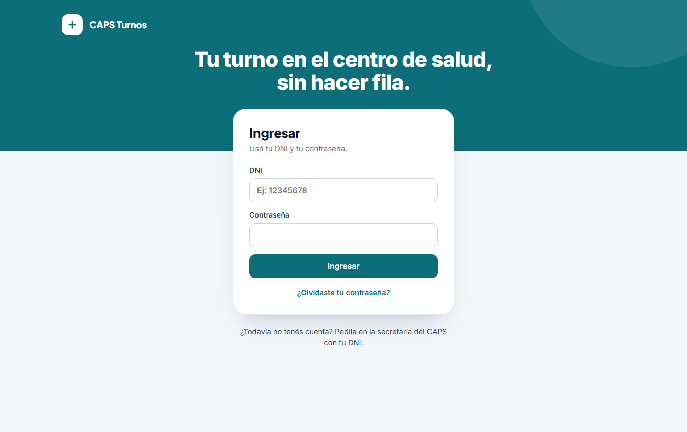

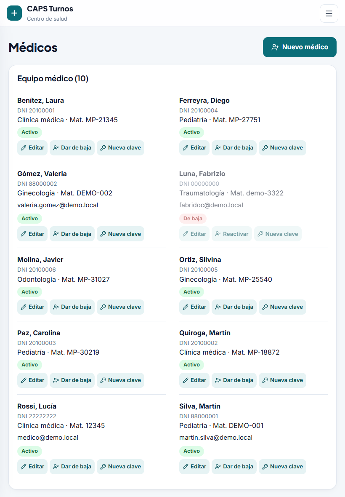

</details>

---

## Instalación en una PC nueva

1. Instalar:
   - **XAMPP** (https://www.apachefriends.org), con MySQL y phpMyAdmin, en la carpeta `C:\xampp` (la que viene por defecto).
   - **Node.js LTS** (https://nodejs.org).
2. Descargar el proyecto: en GitHub, **Code → Download ZIP**, y después clic derecho sobre el `.zip` → **Extraer todo**.
3. Abrir el panel de XAMPP y apretar **Start** en **MySQL**.
4. Doble clic en **`instalar.bat`**. Hace todo solo:
   - instala las dependencias y prepara las pantallas;
   - crea `backend/.env` con claves al azar (si ya existe, lo respeta);
   - crea la base `caps_turnos`, sus tablas y el usuario `caps_app` con sus permisos;
   - carga los usuarios de prueba y, si se lo pedís, los datos de ejemplo completos.

   Pide la contraseña de root de MySQL (en XAMPP viene vacía: apretar Enter). Se puede correr de nuevo sin romper nada.
5. Si es la instalación definitiva, a la pregunta "¿Es la instalación definitiva?" responder **s**: todas las cuentas van a tener que cambiar la clave `demo1234` en el primer ingreso.

> Si Windows muestra "Windows protegió su PC", tocar **Más información → Ejecutar de todas formas**.

## Actualizar a una versión nueva

Para cuando el sistema **ya está instalado** y salió una versión nueva. Los datos (pacientes, turnos, recetas) no se tocan: están en MySQL, no en la carpeta.

1. Cerrar la ventana negra del sistema (si está abierto) y dejar **MySQL** prendido en XAMPP.
2. Descargar el proyecto nuevo (**Code → Download ZIP**) y extraerlo en una carpeta **nueva**. No pisar la carpeta vieja.
3. En la carpeta nueva, doble clic en **`actualizar.bat`**.
4. Cuando lo pida, **arrastrar la carpeta vieja** a la ventana negra y apretar Enter.
5. Al terminar, abrir el sistema con **`iniciar.bat` de la carpeta nueva**. Cuando se vea que todo anda, se puede borrar la carpeta vieja.

`actualizar.bat` copia de la carpeta vieja el `backend/.env` (con las claves de la base y de Gmail) y las copias de seguridad, hace una copia de seguridad nueva, pone la base al día (sin borrar nada), instala y compila. No pide la clave de root ni cambia las claves de nadie. Si algo falla, la carpeta vieja queda como estaba y se sigue usando esa.

## Uso diario

1. Prender **MySQL** en el panel de XAMPP.
2. Doble clic en **`iniciar.bat`**. Se abre el navegador en http://localhost:3001.
3. Para cerrar el sistema, cerrar la ventana negra.

Usuarios de prueba (clave `demo1234`):

| Rol | DNI |
| --- | --- |
| Secretaria | 11111111 |
| Médica | 22222222 |
| Paciente | 33333333 |

Con los datos de ejemplo completos hay además 6 médicos (DNI 20100001 a 20100006) y 300 pacientes (DNI 30200001 a 30200300), con la misma clave y unos 2.200 turnos de los últimos 6 meses.

## Copias de seguridad

Doble clic en **`copia-seguridad.bat`** (con MySQL prendido). Guarda un archivo `caps_turnos_AAAA-MM-DD_HH-MM.sql` en la carpeta `copias/`. Conviene hacerla seguido y pasarla a un pendrive: tiene datos de pacientes, **no subirla a internet**.

Para recuperar una copia: con MySQL y Apache prendidos, entrar a http://localhost/phpmyadmin → base `caps_turnos` → pestaña **Importar** → elegir el archivo `.sql`.

## Mails (recuperar la clave y recordatorios)

Sin configurar, los mails no se envían: se muestran en la ventana negra (sirve para probar). Para mandarlos de verdad con Gmail:

1. Crear una cuenta de Gmail solo para el CAPS y activarle la **verificación en 2 pasos**.
2. En https://myaccount.google.com/apppasswords crear una **contraseña de aplicación** (16 letras).
3. En `backend/.env` completar (la clave de 16 letras va junta, sin espacios):
   ```
   SMTP_HOST=smtp.gmail.com
   SMTP_PORT=465
   SMTP_USER=lacuenta@gmail.com
   SMTP_PASS=las16letras
   MAIL_FROM=CAPS Turnos <lacuenta@gmail.com>
   ```
4. Cerrar y volver a abrir `iniciar.bat` (el `.env` se lee solo al arrancar). Probar con "¿Olvidaste tu contraseña?" en el ingreso.

Los primeros mails de una cuenta nueva suelen llegar a **Spam**. El recordatorio se manda 24 horas antes de cada turno pendiente (`RECORDATORIO_HORAS` en el `.env` cambia las horas). Como el sistema es local, el enlace del mail solo abre en la PC donde está instalado.

**Nunca** compartir ni subir el archivo `.env`: tiene las claves del sistema.

---

## Reglas del sistema

- **Nada se borra, solo se desactiva.** Médicos, pacientes, licencias y feriados se dan de baja y se pueden reactivar. Además, el usuario de la base que usa el sistema (`caps_app`) no tiene permiso para borrar.
- **No hay doble reserva:** dos personas no pueden sacar el mismo horario, aunque lo intenten en el mismo instante (lo frena la base de datos).
- **Privacidad:** el médico ve solo a sus pacientes; la secretaría no ve recetas ni datos clínicos; el paciente ve solo lo suyo. Lo ajeno responde "no encontrado".
- La secretaría no ve nombres de pacientes en su inicio, y las pantallas de Horarios y Turnos no muestran a nadie hasta que se busca.
- Las recetas no se editan, se anulan. Las atenciones terminadas no se editan, se corrigen con notas. La ficha clínica guarda una versión nueva por cada cambio.
- **Seguridad:** contraseñas guardadas con hash, freno de intentos de ingreso (5 fallos = 15 minutos), sesiones que se cierran al cambiar la clave, clave temporal obligatoria en el primer ingreso y enlaces de un solo uso para recuperar la clave y confirmar turnos.

## Cómo está hecho

| Parte | Tecnología |
| --- | --- |
| Pantallas (`frontend/`) | React 19 + Vite, React Router, CSS propio, íconos Lucide |
| Servidor (`backend/`) | Node.js + Express 5 |
| Base de datos | MariaDB 10.4 (la de XAMPP) |
| Mails | Nodemailer (Gmail) y node-cron para los recordatorios |

Instalado, corre **un solo programa**: el servidor atiende la API (`/api/...`) y también las pantallas ya compiladas.

### Base de datos

15 tablas en cuatro áreas: acceso, personas, agenda y turnos, y atención clínica.

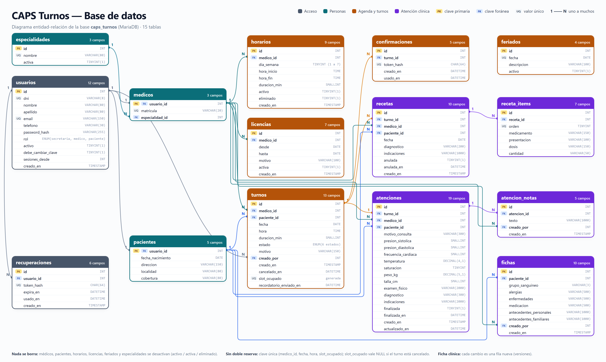

La imagen sale de [`docs/diagrama-base-de-datos.html`](docs/diagrama-base-de-datos.html): si cambia la base, se actualizan ahí las tablas y relaciones y se vuelve a sacar la captura.

```
caps-turnos/
├── instalar.bat, actualizar.bat, iniciar.bat, copia-seguridad.bat
├── backend/
│   ├── index.js              servidor y rutas
│   ├── routes/               una ruta por tema y por rol
│   ├── calculo-turnos.js     cálculo de horarios libres (con pruebas)
│   ├── reservas.js           único camino para reservar un turno
│   ├── db/schema.sql         tablas de la base
│   ├── db/permisos.sql       permisos del usuario caps_app
│   ├── scripts/              instalación, copias, datos de ejemplo y pruebas
│   └── tests/                pruebas automáticas
├── frontend/
│   └── src/
│       ├── pages/            una pantalla por archivo
│       ├── components/       piezas que se reutilizan
│       ├── menus.js          menú de cada rol
│       └── index.css         todo el diseño (colores en variables)
└── docs/
    ├── capturas/             imágenes de este README
    └── diagrama-base-de-datos.png / .html
```

## Para programar

Hace falta `backend/.env` (se puede copiar de `backend/.env.example`). Dos terminales:

```
cd backend
npm run dev        # API en http://localhost:3001
```

```
cd frontend
npm run dev        # pantallas en http://localhost:5173
```

Pruebas, en `backend`:

| Comando | Qué prueba |
| --- | --- |
| `npm test` | el cálculo de horarios libres |
| `npm run probar:permisos` | que cada rol entre solo a lo suyo (con el backend andando) |
| `npm run probar:doble-reserva` | dos reservas al mismo tiempo del mismo horario |

En `frontend`: `npm run lint` (revisión del código) y `npm run build` (compila las pantallas en `frontend/dist`, que después sirve el backend).

## Límites

- Las recetas son **demostrativas** ("DOCUMENTO DEMOSTRATIVO – SIN VALIDEZ"): la Ley 27.553 exige receta electrónica en plataformas registradas.
- La historia clínica no cumple la Ley 27.706 (entre otras cosas, no tiene firma digital).
- Los avisos son solo por mail (no por WhatsApp).
- Es un sistema local: no se puede usar desde fuera de la PC donde está instalado.
